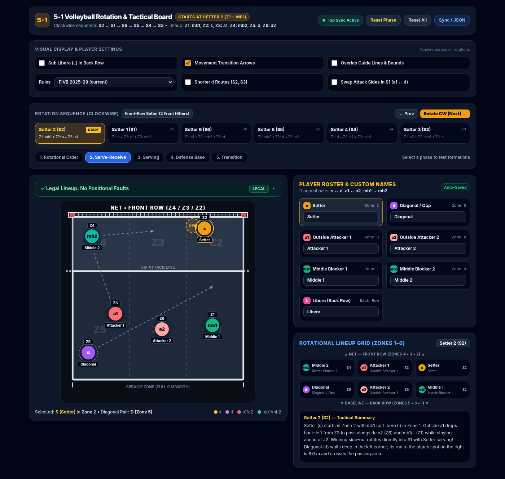

# 5-1 Volleyball Tactical Board

[](https://github.com/wdanilov/tacticalboard/actions/workflows/tests.yml)
[](https://wdanilov.github.io/tacticalboard/)
[](LICENSE)

An interactive board for coaching and learning the **5-1 volleyball system**. It covers
all six rotations and serve-receive, serving, defense and transition formations. It
checks positional (overlap) faults live as you drag players around, following the FIVB
rules.

It is a single HTML file. There is nothing to install or build, it works offline, and it
makes no external requests.

**[Open the board →](https://wdanilov.github.io/tacticalboard/)**



## Contents

- [Features](#features)
- [Quick start](#quick-start)
- [The 5-1 system on this board](#the-5-1-system-on-this-board)
- [Positional rules](#positional-rules)
- [Using the board](#using-the-board)
- [Sharing and sync](#sharing-and-sync)
- [Privacy](#privacy)
- [Simplifications](#simplifications)
- [Development](#development)
- [Credits and licences](#credits-and-licences)

## Features

- **All six rotations** of the 5-1, stepped clockwise (S2 → S1 → S6 → S5 → S4 → S3), with
  a mini lineup grid and tactical notes for each one.
- **Five phases:** rotational order, serve-receive, serving, defense base and transition.
- **Live fault checking** of front/back and left/right order and of players being on the
  court. It covers both the **FIVB 2025–2028 rules** (the serving team may stand anywhere)
  and the **pre-2025 rules** (both teams in order, server exempt).
- **Drag and drop** players to try your own formations. Positions are saved per rotation
  and phase.
- **Movement arrows** from serve-receive to the attack, and from the serve to the defense.
- **Formation options:** shorter routes for the opposite in S2/S3, and swapped attack sides
  in S1.
- **Libero** (optional) replaces the back-row middle blocker, except when that middle serves.
- **Your roster:** name each player; the names appear on the court and in the lineup grid.
- **Sync** between browser tabs automatically, between devices via Firebase, or by
  JSON export/import.
- **Offline and self-contained:** CSS and the Inter font are embedded in the file.

## Quick start

- **Online:** open <https://wdanilov.github.io/tacticalboard/>.
- **Offline:** download [`index.html`](index.html) and open it in any modern browser
  (Chrome, Edge, Firefox, Safari), on desktop, tablet or phone.

Your board (names, positions and settings) is saved in the browser automatically.

## The 5-1 system on this board

### Roles

| Code | Role | Diagonal partner |
| --- | --- | --- |
| `s` | Setter, the only one, sets in all six rotations | `d` |
| `d` | Diagonal / opposite | `s` |
| `a1`, `a2` | Outside attackers | each other |
| `mb1`, `mb2` | Middle blockers | each other |
| `L` | Libero (optional), replaces the back-row middle | – |

Diagonal partners are always three zones apart. One of each pair is in the front row and
the other in the back row.

### Zones and the starting lineup

Seen from your own baseline, with the net at the top:

```
                NET
   ┌─────────┬─────────┬─────────┐
   │   Z4    │   Z3    │   Z2    │   front row
   │  mb2    │   a1    │   s     │
   ├ ─ ─ ─ ─ ┼ ─ ─ ─ ─ ┼ ─ ─ ─ ─ ┤   3 m attack line
   │   Z5    │   Z6    │   Z1    │   back row
   │   d     │   a2    │  mb1    │
   └─────────┴─────────┴─────────┘
          service zone (full 9 m)
```

The board starts in **Setter 2 (S2)**, shown above. Rotations are named after the setter's
zone. "Rotate CW" moves every player one zone clockwise (Z2 → Z1 → Z6 → Z5 → Z4 → Z3 → Z2),
so the sequence is **S2 → S1 → S6 → S5 → S4 → S3**.

- **Front-row setter (S2, S4, S3):** two front-row attackers; the setter can attack the
  second ball.
- **Back-row setter (S1, S6, S5):** three front-row attackers; the setter penetrates from
  the back row to the target.

### Serve-receive formations

Three players pass in every rotation: both outside attackers plus `L`, meaning the libero,
or the back-row middle when the libero is off. Setter run is the distance from the
setter's start spot to the target.

| Rotation | Setter | Passers (left → right) | Setter run | Notes |
| --- | --- | --- | --- | --- |
| S2 | Z2, already at the target | a1, a2, L | 0.6 m | d waits deep in the left corner (8.0 m to its attack spot) |
| S1 | Z1, tucked behind a1 at the right sideline | a2, L, a1 | **5.8 m** (longest) | After the pass, a1 and d swap sides |
| S6 | Z6, right behind d at the net | a2, L, a1 | 1.5 m | |
| S5 | Z5, behind mb1 at the left net | a2, a1, L | 4.7 m | Runs along the net |
| S4 | Z4, front left; front row stacks left | a2, a1, L | 5.5 m | d waits deep in the right corner |
| S3 | Z3, at the target | a1, L, a2 | 0.4 m | d waits deep between L and a2 (4.2 m run) |

**Formation options** (in the settings panel):

- **Shorter d Routes (S2, S3):** the back-row opposite waits at the net instead of deep.
  - In S2 it stands between mb2 and the setter: a 4.7 m run instead of 8.0 m, without
    crossing a1's approach.
  - In S3 it stands right behind the setter: 2.5 m instead of 4.2 m.
- **Swap Attack Sides in S1:** for the first attack, a1 hits from the right and d from the
  left. Without this option they swap sides, running 7.5 m and 7.2 m.

## Positional rules

At the moment of the service hit, each player is checked against their neighbours:

- **Front/back pairs:** Z4 ahead of Z5, Z3 ahead of Z6, Z2 ahead of Z1.
- **Left/right in each row:** Z4 left of Z3 left of Z2, and Z5 left of Z6 left of Z1.
- **On the court:** every player except the server must be on the court.

Choose the rule edition in the settings:

| Setting | Receiving team | Serving team |
| --- | --- | --- |
| **FIVB 2025–28 (current)** | Must be in rotational order | Free to stand anywhere; the board starts them at their defensive spots |
| **Pre-2025 (both teams)** | Must be in rotational order | Must be in order too (server exempt); the board stacks them as close to their defensive spots as the rules allow |

After the service hit, players may move freely, so the defense and transition phases are
not checked. National leagues may still use older rules; check yours.

## Using the board

| Control | What it does |
| --- | --- |
| **Rotation buttons**, ← Prev / Rotate CW (Next) → | Pick or step through the six rotations |
| **Phase buttons** | Rotational order, serve-receive, serving, defense base, transition |
| **Drag a player** | Move them; the lineup is re-checked live |
| **Click a player** | Select them; their diagonal partner is highlighted. With guide lines on, in phases that are checked, their legal area appears as a green box |
| **Lineup banner** | Shows Legal / Fault / Free / In Play. Click it, or press Enter, for the explanation |
| **Sub Libero (L) in Back Row** | Libero replaces the back-row middle (off by default) |
| **Movement Transition Arrows** | Arrows in serve-receive (to the attack) and serving (to the defense) |
| **Overlap Guide Lines & Bounds** | Draws the neighbour relationships and the selected player's legal area (off by default) |
| **Rules** | FIVB 2025–28 or pre-2025 (see [Positional rules](#positional-rules)) |
| **Shorter d Routes / Swap Attack Sides in S1** | Formation options (see above) |
| **Player Roster** | Rename players; names appear on the court and in the lineup grid |
| **Reset Phase** | Restores the default positions for the current rotation and phase |
| **Reset All** | Restores everything to the defaults, on all synced tabs and devices (the Firebase connection stays) |
| **Sync / JSON** | Firebase connection and JSON export/import |

Custom positions take priority over defaults. If you have moved a player and later turn on
a formation option, click **Reset Phase** to see the option's position.

## Sharing and sync

### Between browser tabs

This is automatic. Open the board in several tabs of the same browser, and every change
appears in all of them.

### Between devices (Firebase)

1. Create a project in the [Firebase console](https://console.firebase.google.com/) and add
   a **Realtime Database**.
2. Allow public access to one path, for example:
   ```json
   { "rules": { "board": { ".read": true, ".write": true } } }
   ```
3. On each device, open **Sync / JSON**, paste the database URL with `/board.json` appended
   (`https://<project>-default-rtdb.<region>.firebasedatabase.app/board.json`), and click
   **Connect**.

When you connect, an existing shared board replaces the local one, and an empty database
receives yours. The badge in the header shows *Connecting*, *Synced* or *Error*. To
disconnect, clear the URL and click Connect.

> [!WARNING]
> The database must allow public read and write, so anyone who knows the URL can change
> or delete the board. Use a long, hard-to-guess path, and don't store anything sensitive.

### JSON export / import

**Sync / JSON** shows the board as JSON (settings, names and custom positions) to copy and
paste elsewhere. Importing a partial JSON object changes only the fields it contains.
The Firebase URL and your current selection are never exported.

## Privacy

The page loads no scripts, styles or fonts from other servers. Everything you enter stays
in your browser's local storage, unless you connect a Firebase database.

## Simplifications

- **Positions** are checked by each player's centre point with a small tolerance (about
  8 cm), not by individual feet.
- **Libero:** in the defense and transition phases the libero is shown for the back-row
  middle, even right after that middle served.
- **Transition:** front-row attackers are shown at the net, not at their approach
  starting points.

## Development

Everything lives in [`index.html`](index.html): HTML, CSS, JavaScript and the embedded
font. It uses no framework. The court is drawn in SVG, players move with pointer events,
and styling uses Tailwind CSS classes compiled into the page.

```
index.html                    the app
build-css.py                  regenerates the inlined Tailwind CSS
script.readme.md              when and how to run build-css.py
tests/                        browser tests: run.py, board.test.js, fakes.js, README.md
docs/screenshot.png           the image above
LICENSE                       CC BY-NC 4.0 licence of the board
licenses/Inter-OFL.txt        licence of the embedded font
.github/workflows/tests.yml   CI on GitHub Actions
```

- **Editing:** change `index.html` and reload the browser.
- **New Tailwind classes:** if you use a class the page didn't use before, run
  `python3 build-css.py` (Python 3.6+). See [`script.readme.md`](script.readme.md).
- **Tests:** run `python3 tests/run.py` (Python 3.7+ and Google Chrome or Chromium). It
  runs 80 checks offline in headless Chrome in a few seconds. See
  [`tests/README.md`](tests/README.md).
- **CI:** every push to `master` and every pull request runs the tests, and checks that the
  inlined CSS is up to date.
- **Deployment:** GitHub Pages publishes `master`, so a push goes live within a minute or two.
- **Storage:** the board is saved in `localStorage` under `vb_5_1_tactical_board_v5`, and
  tabs sync over the `BroadcastChannel` named `vb_5_1_sync_v5`.

## Credits and licences

- **Inter** typeface, © The Inter Project Authors, under the
  [SIL Open Font License 1.1](licenses/Inter-OFL.txt).
- **[Tailwind CSS](https://tailwindcss.com)** v3.4.17 (MIT License) generates the
  embedded stylesheet.
- The positional rules follow the FIVB Official Volleyball Rules 2025–2028.

The board itself is © 2026 Wladimir Danilov, licensed under
[CC BY-NC 4.0](https://creativecommons.org/licenses/by-nc/4.0/) (see [`LICENSE`](LICENSE)).
You may share and adapt it with attribution, but not for commercial purposes. The font and
the generated CSS keep their own licences listed above.
